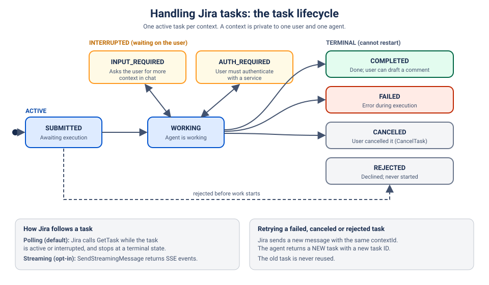

In this repository:

- the Forge app is [`apps/forge`](../../apps/forge);
- the remote service is [`apps/remote`](../../apps/remote); and
- the remote agent is played by the scenario simulator in [`apps/scenarios`](../../apps/scenarios).

---

---

---

