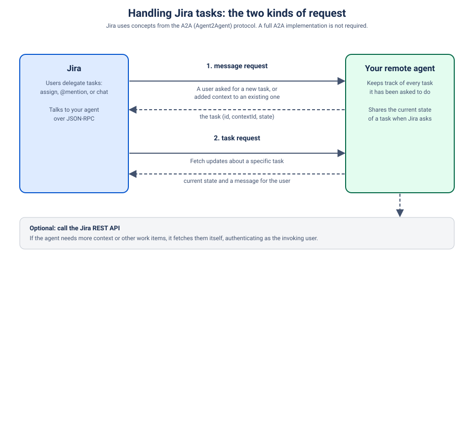
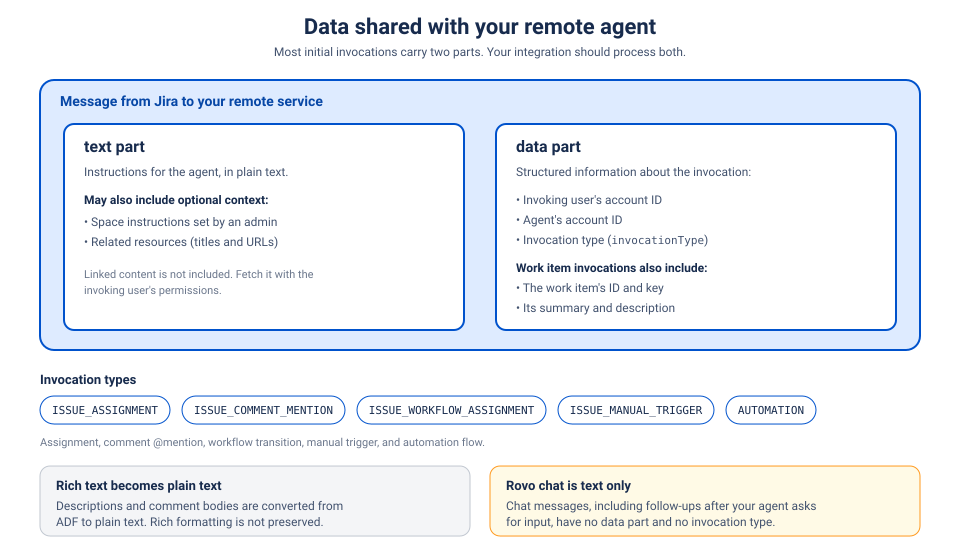

<!-- Chart spacing: GitHub strips blank-line tricks ( , &nbsp;), so every chart SVG carries 160px of white padding at the bottom (extra height in both viewBox and the background rect). Add the same padding to any new chart. -->

In this repository:

- the Forge app is [`apps/forge`](../../apps/forge);
- the remote service is [`apps/remote`](../../apps/remote); and
- the remote agent is played by the scenario simulator in [`apps/scenarios`](../../apps/scenarios).

---

---

---

