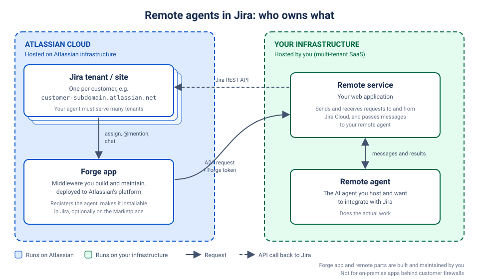
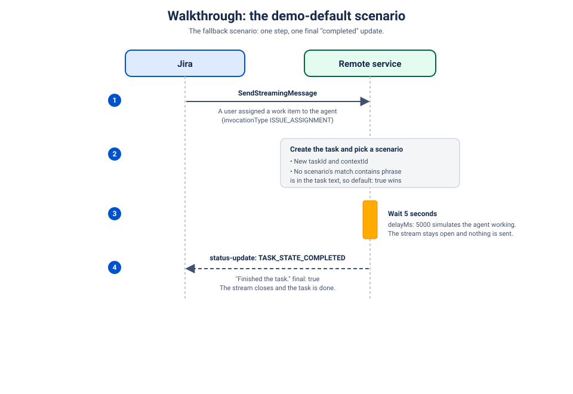
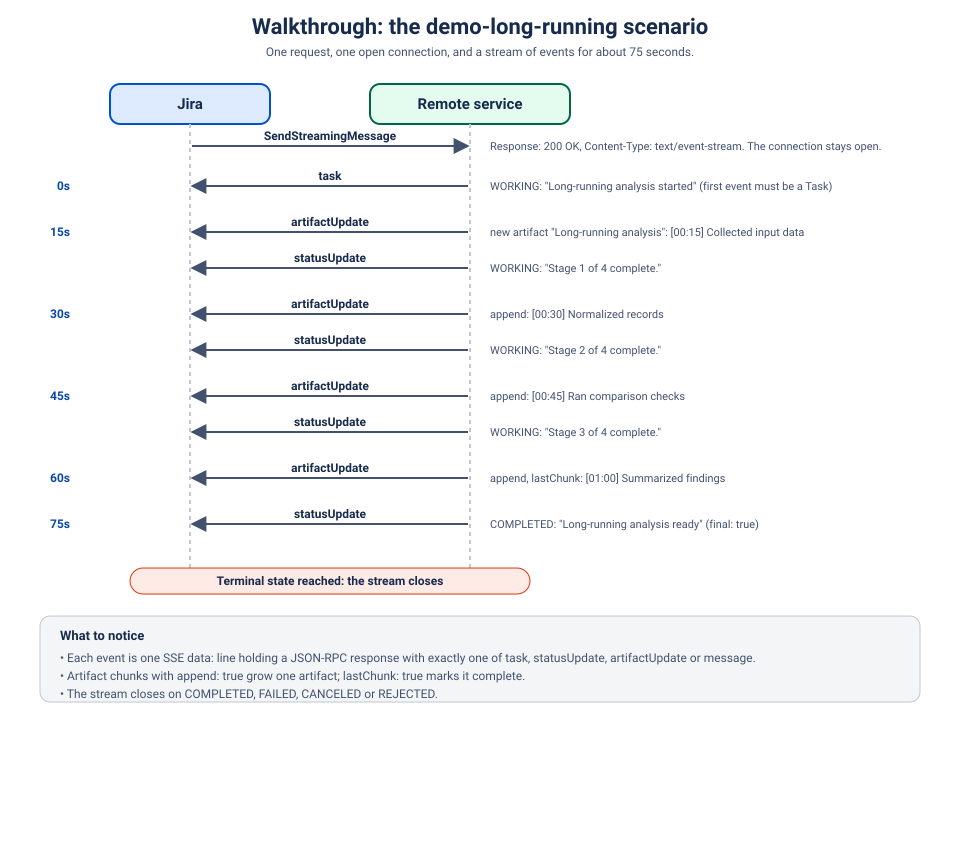
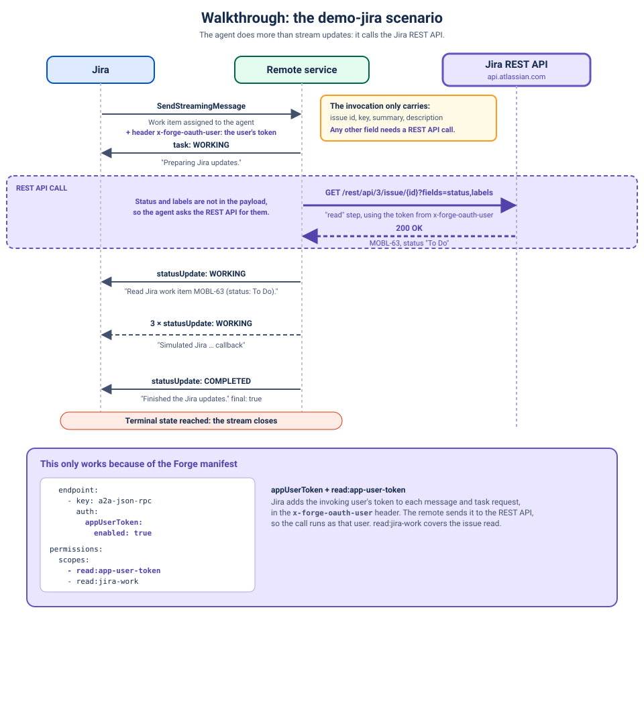
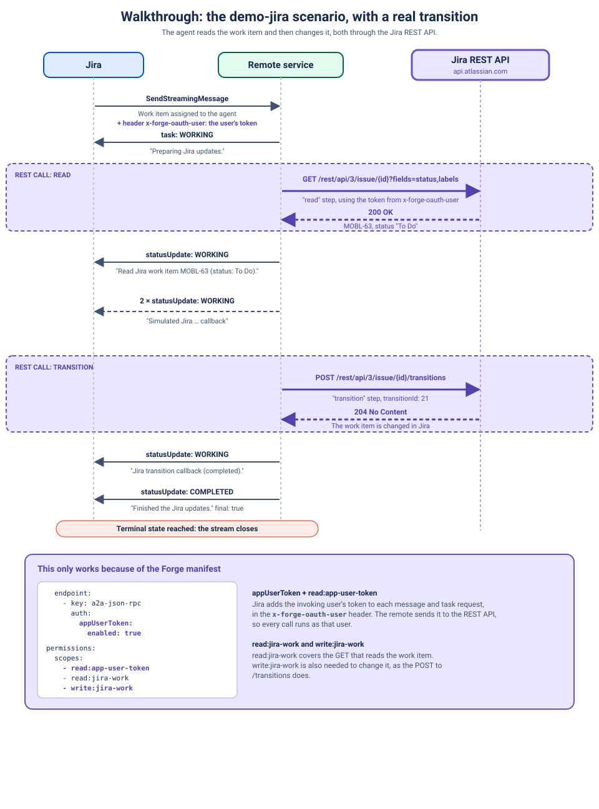
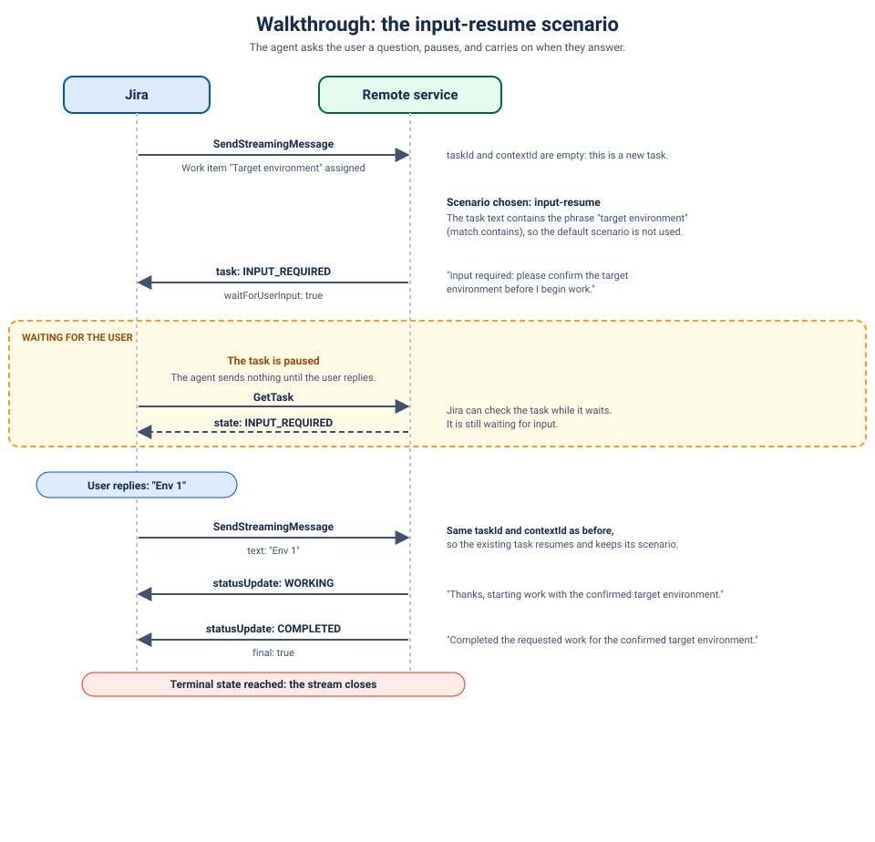

<!-- Chart spacing: GitHub strips blank-line tricks ( , &nbsp;), so every chart SVG carries 160px of white padding at the bottom (extra height in both viewBox and the background rect). Add the same padding to any new chart. -->

In this repository:

- the Forge app is [`apps/forge`](../../apps/forge);
- the remote service is [`apps/remote`](../../apps/remote); and
- the remote agent is played by the scenario simulator in [`apps/scenarios`](../../apps/scenarios).

---

---

---

The scenario is defined in [`apps/scenarios/demo-default.yaml`](../../apps/scenarios/demo-default.yaml).

---

The scenario is defined in [`apps/scenarios/demo-long-running.yaml`](../../apps/scenarios/demo-long-running.yaml).

---

The scenario is defined in [`apps/scenarios/demo-jira.yaml`](../../apps/scenarios/demo-jira.yaml).

---

The scenario is defined in [`apps/scenarios/demo-jira.yaml`](../../apps/scenarios/demo-jira.yaml), with the `transition` step set to `real: true`.

---

The scenario is defined in [`apps/scenarios/input-resume.yaml`](../../apps/scenarios/input-resume.yaml).

